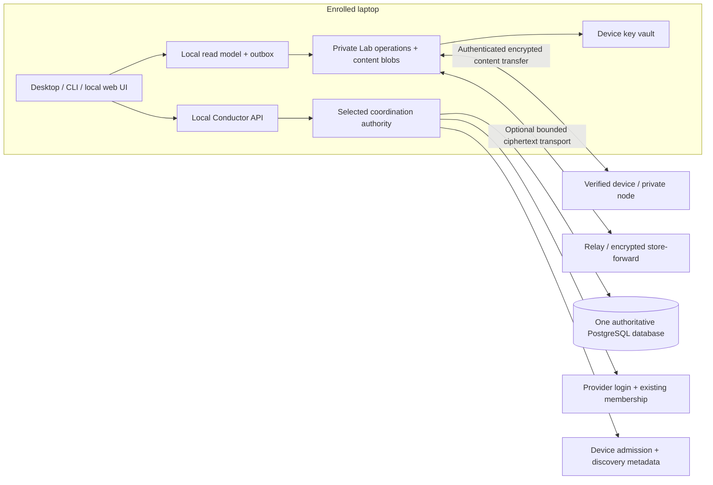

# Local-first P2P architecture

Status: proposal for review; this document implements no new runtime feature.
Source baseline: Conductor `3244ecbbc7a01229e3a33588994ef445305e2660` and Cairn
`d782a50822b93ff7189cb260674e648eb6697074`, audited on 2026-10-17.
The [roadmap](local-first-p2p-roadmap.md) turns this design into gated PRs.
Pinned trees: [Conductor](https://github.com/aburan28/conductor/tree/3244ecbbc7a01229e3a33588994ef445305e2660)
and [Cairn](https://github.com/aburan28/cairn/tree/d782a50822b93ff7189cb260674e648eb6697074).

## Outcome and provisional scope

A person should launch Conductor on a laptop, sign in with an allowed Google,
GitHub or enterprise account, reopen their work after a restart, and explicitly
approve another device to obtain selected workspaces and history. Laptops and
chosen nodes retain durable local copies. A backend helps with identity,
membership, discovery and online coordination; optional services carry encrypted
content while the sending laptop sleeps. AWS is a deployment choice.

Two product assumptions remain provisional:

1. Restoration includes history, workspace files and native harness continuation
   where supported. It does not migrate running process memory, PTYs, model
   provider credentials or arbitrary application memory. A live remote process can
   be reconnected to only through a separately supported runtime interface.
2. An explicit opt-in permits encrypted cloud backups/store-forward. Users may
   instead choose metadata/transport-only hosting, private nodes or no cloud.
   No peer and no available backup means **unavailable**, never restored.

Changing these choices changes retention, storage and acceptance scope; it does
not change the existing task authority or imply OAuth can decrypt content.

## What exists today

Source anchors below refer to the pinned baseline, not promises inferred from
`DESIGN.md`. Line ranges identify the inspected implementation.

| Area | Source-backed implementation | Boundary or gap |
| --- | --- | --- |
| Google / enterprise OIDC | `internal/sso/oidc.go:56–118,215–287`: discovery, PKCE and token validation; `:310–344`: restricted Entra trusted-email policy | Configured provider/control plane must be reachable for fresh sign-in |
| GitHub / GitHub Enterprise | `internal/sso/github.go:56–128`: OAuth exchange, user/emails/org/team lookups and stable numeric subject | This is account authentication, separate from a GitHub installation or agent provider login |
| Account linking | `internal/api/sso.go:390–402,505–538,681–763`; `internal/db/migrations/0012_sso.sql:9–22` | Existing access plus provider control links accounts; SSO redemption creates a bearer token, no device key or file-decryption key |
| Team identity | `internal/domain/types.go:23–30`; `internal/db/migrations/0001_init.sql:60–67` | A principal belongs to one organization; roles are project memberships. Multi-organization account switching must respect that model |
| Authentication restoration | `internal/client/client.go:218–270`; `internal/web/static/lib/store.js:26–35`; `internal/web/static/app.js:149–165` | CLI private credentials and browser localStorage are separate; browser reload validates `/v1/whoami`. Neither restores workspace keys |
| Local / remote placement | `macos/Sources/ConductorKit/Supervisor.swift:83–104,173–207`; `cmd/conductor/up.go:60–71,318–327,481–512`; `internal/db/db.go:30,135` | Bundled/local PostgreSQL or external PostgreSQL is real. A remote API attachment is a separate choice. There is no replicated local/cloud coordination database |
| Authority selection | `macos/Sources/Conductor/AppModel.swift:131–137` plus `Supervisor.swift:99–104` | A failed optional external-DSN read can select bundled PostgreSQL. Explicit fail-closed authority selection is new work |
| Claims and fencing | `internal/db/claim.go:130,213,448,635,703`; `internal/db/session.go:123`; `internal/runner/runner.go:427` | Transactional claims, epochs and expiry are authoritative. Transport loss does not create permission to renew or publish offline |
| Session and content recovery | `internal/localstate/localstate.go:1,35,89,221`; `internal/checkpoint/checkpoint.go:1`; `internal/checkpoint/workspace.go:16,108,160`; `internal/checkpoint/resume.go:58,111` | Resume records are process metadata, not conversations. Checkpoints contain transcripts/workspace layers with exclusions and limits; continuation is not process migration |
| Backup and durability | `cmd/conductor/backup.go:22,361`; `cmd/conductor/checkpoint.go:847,931–947`; `internal/checkpoint/store.go:43–84`; `internal/localstate/localstate.go:118–134` | Separate S3 resume-record/checkpoint backup and passphrase sealing exist. Temp/rename writes alone do not specify power-loss transactions; a checkpoint may omit workspace layers |
| Events / artifacts / memory | `internal/db/event.go:31`; `internal/api/handlers.go:1574–1600`; `internal/api/hub.go:185`; `internal/db/evidence.go:18`; `internal/memory/config.go:1` | Notification outbox/SSE is not device anti-entropy; artifacts are URI/hash metadata; optional Redis memory is a separate user store |
| Networking / desktop | `internal/peer/peer.go:1–9`; `internal/wireguard/render.go:13–38`; `internal/nat/nat.go:64`; `macos/Sources/Conductor/ConductorApp.swift:17`; `cmd/conductor/systemd.go:163` | mTLS probes, static WireGuard rendering, UPnP/Tailscale exposure and macOS/Linux lifecycle exist. No arbitrary file-sync or relay engine follows from them |

Additional constraints: provider group disappearance does not itself remove
memberships (`internal/api/admin_sso.go:107–110`). Execution-session presence and
heartbeats are database records (`internal/db/session.go:55–63,139–160`), not
conversation storage. Dashboard local resume acts on the daemon host
(`cmd/conductord/main.go:666`), not whichever laptop opened a browser. Static
inspection also suggests a daemon/CLI executable-selection concern in
`internal/resume/resume.go:72,163`; runtime reproduction belongs in the roadmap,
not an assertion that resume has been repaired.

## Authorities and local ownership

There are two different consistency problems. Preserve Conductor's online
coordination decisions; replicate user content through a separate content model.
Never copy PostgreSQL files between live independent writers or replay cached
claims into another authority.

| State | Authority | Durable local copy and behavior |
| --- | --- | --- |
| Principal, provider links, organization, project membership, token status | Selected Conductor PostgreSQL authority | Minimal account/project display snapshot with authority ID, fetch time and version; stale offline snapshot cannot authorize a new member/device |
| Tasks, attempts, claims, reservations, fences, audit records | Same selected PostgreSQL authority | Selected task/session read model and receipt cache; offline user intents remain pending proposals, never accepted claims/renewals/finishes |
| Workspace file/document/history operations | Authorized private Cairn Lab workspace, subject to integration gates below | Local signed operation set and referenced blobs on enrolled nodes; concurrent versions may coexist until explicit resolution |
| Transcript/checkpoint content | Local checkpoint store, referenced by private workspace manifests | Original/native formats plus explicit completeness inventory; replication only when selected and authorized |
| Local resume state / view preferences | Device-local Conductor state | Durable device-bound metadata; paths, PID/TTY and installed harness references are not portable execution state |
| Devices, admission and membership-to-workspace mapping | Existing Conductor account/project authority, with verifiable device/owner approvals | Pinned device/roster checkpoints and key envelopes; no independent competing account or task database |
| Workspace encryption keys | Verified enrolled devices; optional declared recovery custodians | OS-protected local key material and signed recipient envelopes; never derivable from an OAuth cookie or stored in discovery metadata |
| Discovery, reachability, relay spool indexes | Rebuildable service projections / bounded ciphertext spool | Last-known candidates and transfer receipts; neither is proof of membership, file durability or task authority |

A new local read model may use a transactional embedded index for selected
non-secret account/task/session metadata, queue state and verified receipts. It
is a projection with authority provenance, not another identity database. Lab
remains the content operation store. Benchmark existing stores before selecting
an embedded index; its crash/format contract must precede implementation.

The device UI must distinguish `local`, `queued`, `replicated to device X`,
`backed up`, `conflicted`, `locked`, `stale authority` and `unavailable`. A locally
durable write is not an acknowledgment from another node. An empty cache is not
an empty remote workspace.
Personal sessions/history are private by default. Publishing a workspace or
session to a team is explicit, scoped to organization/project/role, and enforced
on metadata, manifests, blobs and export. Team membership alone does not publish
every personal transcript. Local ownership includes an inspectable durable
catalog and portable export, not just browser localStorage.

Manifests and UI distinguish pinned complete local copies from placeholders and
evictable cache objects. A visible filename is not proof its bytes are available;
eviction cannot remove the last pinned copy. Backup receipts identify the holder,
objects, retention and durability boundary, not survival of all possible failures.

`CP` can be the laptop's local daemon/database, a private enterprise service, or
a hosted service. A workspace names its authority explicitly. Independent local
authorities have distinct namespaces; joining a team is an explicit enrollment
and import/mapping operation, not automatic database merging.

## Journeys and failure behavior

**First laptop.** Choose a deployment profile and authority before sign-in. Start
or attach to that authority, verify its identity, and use existing provider login
or approved local/enterprise authentication. Create/unlock the device vault and
verify its binding to the account. Offer a recovery choice, workspace selection,
storage budget and explicit cloud-backup choice. A failed configured credential
read blocks startup of that authority; it never silently creates another one.

**Same-laptop restart.** Open local history/files and cached task/account/session
metadata without requiring backend availability. Show lock/staleness state.
Reconnect validates current membership/token status before mutations. Resume a
surviving harness, install a supported native checkpoint, or offer a continuation
document with its limitations. Never label a new conversation as the same resumed
process. A terminal that no longer exists cannot have its scrollback invented.
Opening restores the catalog/history and selected files first, then reattaches a
reachable agent or resumes a supported checkpoint under fresh authority. It must
not replay tool side effects, re-run historical jobs automatically, revive revoked
credentials, or reuse old fencing epochs.

**Second laptop.** Authenticate to the same account/authority, then prove device
admission using a verified existing device, recovery secret, or declared enterprise
escrow. Verify the recipient key out of band or through a documented independent
witness policy. Obtain key envelopes and manifests from an available enrolled
node or opted-in encrypted backup, verify them, and fetch only selected content.
Surface omissions/missing objects before offering restore. No surviving key,
authorized peer or recoverable backup means no recovery.

**Disconnected work.** Read and edit locally durable content and append local
content operations. Cache selected task metadata and queue explicit user intent
with its original authority/version. Once the known coordination lease expires,
stop presenting protected work as owned; fail closed on publish/finish/secret
fetch. Offer an isolated scratch branch/proposal. On reconnect revalidate identity,
membership and authority, refresh task state, and require a new claim when needed.
Conflict with a new owner is shown, never hidden by retrying a stale fence.

**Laptop asleep or lost.** Another device restores only objects that a durable
replica/backup actually acknowledged. Presence, a manifest or an S3 object listing
alone is not availability proof. Lost-device revocation stops future authorized
admission and rotates future key epochs; it cannot erase content already copied.

## Identity, device admission and team isolation

Reuse existing SSO/provider linking and project RBAC. Do not equate email address,
GitHub login, Google cookie, agent API account, operating-system user, device key,
task session or Cairn settlement identity. Keep issuer/subject and existing
principal IDs; never merge accounts solely because displayed emails match.
Switching organizations must respect the current single-organization principal
constraint until an explicitly reviewed migration changes it.

Proposed additive device records reference the existing principal and authority:
stable device ID, public signing/transport key bindings, state, enrollment proof,
approved scopes, expiry, revocation version and audit references. Private keys
remain on devices. Reuse Cairn-supported Lab author/transport identity where safe;
bind any distinct keys explicitly. WireGuard keys and provider tokens are not
content-signing/recovery keys. These records and endpoints are proposed contracts,
not existing APIs.

Enrollment is challenge-bound to account, authority, device keys, intended
projects, expiry and nonce. Existing trusted-device approval verifies that exact
tuple. Recovery-secret enrollment proves possession of an independently stored
secret. Enterprise escrow is a separate administrator-visible capability with
audited custody; it weakens the claim that only the user can read content.

All content requests need authenticated device identity **and** current scoped
admission; connection to a mesh/VPN is insufficient. Bind every object/event to
authority, organization, project/workspace and key epoch. Enforce quotas and
membership before disclosing inventory, not only before returning bytes.
Never reuse a project-scoped content capability, envelope or cache namespace for
another project. Existing principal-wide Conductor login tokens retain their
current authorized-project semantics; they are not content key envelopes.
Per-project membership removal, account deactivation, token revocation, device
revocation, provider unlink and WireGuard withdrawal are distinct transitions.

Online authority rejects new publication from revoked devices even when an old
signature verifies. Offline replicas can only display last-known admission and
continue reading keys they already possess; immediate offline global revocation
is impossible. Key distributors must stop issuing new envelopes when their
admission snapshot expires; unavailable authority cannot extend that snapshot.
Queued operations arriving after revocation are preserved locally
but quarantined/refused until policy-authorized recovery/review. Cairn Lab causal
revocation can change an effective view as missing revocation arrives; expose that
transition instead of treating all previously visible operations as permanent.

### Malicious control plane and key substitution

TLS plus provider login alone trusts the backend to publish honest device keys.
An E2EE claim must not silently grant that backend the power to enroll a reader.
Existing devices pin an owner/workspace trust root and verify signed roster
updates and recipient key fingerprints before wrapping content keys. A backend
cannot add an arbitrary key merely by returning a device row. Require verified
device approval or an explicit trusted recovery/escrow action for new recipients.

First-device bootstrap is a trust boundary: absent an independently verified
owner key or witness, it is TOFU and must be labeled. An append-only log operated
only by the same backend cannot by itself prevent equivocation. Evaluate signed
checkpoints with peer gossip or independent witnesses, inclusion/consistency
proofs and roster-version pinning. Record which verification a recipient used.
Loss of all witnesses/high-water marks limits rollback detection during recovery;
do not promise proof of freshest state from an untrusted single source.
The backend can still deny service, hide availability and observe traffic metadata.

## Content engine and synchronization protocol

Prefer adapting Cairn Lab rather than building a second CRDT. Its existing private
layer has signed operation sets, causal closure, multi-value file/document
registers (`cairn/src/lab/mod.rs:1–30`), local `ops.jsonl`, content-addressed blobs
and an advisory local writer lock (`src/lab/store.rs:1–30`). Directory, network and
bundle carriers use bucket reconciliation and authorized ingest
(`src/lab/sync.rs:1–100,396+`). Lab leases are advisory, not Conductor locks.
See the [existing integration context](cairn-integration.md); this proposal does
not modify Cairn's settlement ledger or publish private content to it.

Before reuse, a contract test must prove canonical Conductor membership/device
admission maps to Lab authorization without creating a competing membership
authority. Define how signed Conductor admission snapshots are represented,
refreshed and revoked in the Lab boundary. If semantics cannot be preserved,
stop for an ADR; do not dual-write two unrelated membership systems and hope they
converge. API shape, lifecycle ownership and schema versions remain spike outputs.
Conductor owns app lifecycle, local catalog/device/account/task authority and sync
orchestration. Cairn Lab is the content operation/storage engine candidate behind
a versioned local IPC/CLI adapter, not raw FFI or a task/database rewrite. Its
explicit commit/sync operations are not a filesystem watcher or reliable background
sync service; watcher reconciliation, durable outbox and scheduling are new work.

Expose the internal Rust Lab API through a CLI or authenticated local IPC bridge
with explicit capabilities: `src/lab/api.rs:36,88,117` has conditional file
operations (`ExpectCurrent`/`Seen`/`Absent`). It is not a Conductor account API.
Do not enable `CAIRN_LAB_HTTP` or use the existing `/workspaces` and
`/workspace/{space}` publication routes for private content: their opted-in HTTP
read surface publishes referenced content (`src/serve.rs:1185,1647–1649,5050–5123`).
Likewise the public research `/log` path deliberately decrypts ledger content;
ledger-at-rest sealing is not a confidential enterprise content API.

Proposed sync phases:

1. Negotiate supported versions, bounded sizes and authenticated admission.
   Exchange verified workspace/roster checkpoints and causal frontiers.
2. Reconcile operation IDs/buckets using Lab's verified operation-set machinery.
   Request causal predecessors before materializing a dependent view. Deduplicate
   by signed operation ID; reject ID/body mismatch, wrong scope and invalid author.
3. Transfer signed encrypted manifests and missing ciphertext chunks, with bounded
   concurrent requests, backpressure and per-peer/workspace/disk quotas.
4. Verify integrity/authentication, durably commit blobs and operation references,
   then acknowledge a precise frontier/object set. Notification/UI events are
   derived after commit. On reconnect repeat idempotently from durable receipts.

Use domain-separated, versioned signed records binding workspace, author/device,
device sequence, predecessor/parent IDs, payload digest, key/roster epoch and
operation purpose. Preserve Lab's canonical signed format or extend it through
its supported versioning; do not bolt on an incompatible second event log.
Device counters aid replay/gap detection but do not impose a total global order.
Do not order conflicting edits by wall clock. Coordination decisions still come
from PostgreSQL transactions, not content-log causality or a device signature.

Existing Conductor SSE is a UI refresh seam, not this protocol: it has limited
backlog and process-local cursors, with no durable per-client reconnect or
acknowledgment protocol. Database event IDs exist, but SSE `id:` frames and
`Last-Event-ID` replay are not implemented. Add durable read-model
receipts/outbox transactions where required; never use notification delivery as
proof a file or task mutation reached another laptop.

### Large files, manifests and durability

Lab streams large blobs and currently uses 4 MiB network frames; its temporary
hashed writer validates whole blobs. It does not yet provide persisted chunk
offsets/crash-resumable transfer queues (`src/lab/store.rs:176–190,242,384–421`;
`src/lab/sync.rs:396+`). The public verifier's separate 1 MiB blob limit
(`src/blobs.rs:81`) is not Lab's limit; this plan neither raises that public limit
nor routes private files through that public path.

For resumability, introduce a versioned immutable manifest with bounded chunk
size, ordered chunk IDs/lengths, total length, encryption suite/epoch and a root
commitment. Address encrypted chunks by their ciphertext hash. Keep plaintext
hashes, paths and meaningful filenames inside encrypted payloads. Avoid
cross-tenant plaintext deduplication and deterministic encryption leakage.
Choose chunk size by measurement; existing frame size is not a protocol decision.

A persisted transfer journal records verified chunks, expected root, peer/source,
retry budget and completion receipts. Resume at authenticated chunk boundaries;
an HTTP Range response alone does not authenticate bytes. Validate bounds and
final root before atomic publication. Fsync files and parent directories, define
atomic index/blob ordering and recover orphaned temporary objects after crashes.
An ACK means the documented durable boundary, not merely socket receipt.
Bound disk reservation before transfer, reject decompression/resource bombs,
throttle background traffic and expose disk-full/quota/cancel/retry states.

Retention pins referenced/live or explicitly saved versions. GC must account for
offline replicas, tombstones, checkpoints and backup receipts; it cannot delete a
last required object on the assumption an offline device has it. Define offline
retention windows and require a fresh baseline after a replica exceeds them.

## Files, conflicts and harness state

Keep concurrent file/document versions until an explicit resolution operation
names its parents. Text merge can propose a three-way merge; binary conflicts
retain both versions. Rename/delete/edit races remain visible. Tombstones are
causal records with retention, not immediate filesystem destruction.

Materialize into a selected sandbox/worktree after canonical path validation:
reject absolute/traversal paths, escaped symlinks/hardlinks, device files, FIFOs
and special permission escalation. Define Unicode/case collisions, executable
bits, platform-invalid names and symlink support per platform. Do not follow a
link to collect another directory. Preview changed/deleted paths before applying
an imported snapshot; never overwrite uncommitted user work silently.

Git remains the code history/review boundary. Do not sync live `.git` internals,
index locks, worktree metadata, credential helpers, sockets or another running
checkout. Use commit references/bundles and explicit patches/workspace snapshots;
reconstruct in isolated worktrees and pass normal review/tests before merging.
Tracked commits/refs travel through Git transport; selected dirty/untracked
checkpoint artifacts use private content transfer. Never synchronize PostgreSQL
data directories. Virtual workspace IDs map to explicitly chosen local roots;
machine absolute paths and OS credentials do not travel as portable root mappings.
Respect `.gitignore` plus explicit secret exclusions; ignored is not synonymous
with secret. Default-deny `.env`, credential stores, private keys and provider
state, offer an explicit reviewed include policy, and scan before export.
Transcripts can contain secrets despite filenames; user consent and retention
policy apply to their content too.

Restoration manifests distinguish metadata, native transcript, continuation text,
tracked/untracked files, unpushed commits, attachments and omitted layers. Record
harness/version, repository identity/base commit and completeness/error inventory.
Resume requires compatible tools/state formats and explicit local path remapping.
Show unsupported formats as readable history or continuation, not successful
native resume. No promise of moving remote memory or a running agent's execution.

## End-to-end encryption and recovery

Current Lab operations/blobs and bundles are plaintext at rest
(`cairn/docs/lab.md:402–423`). Existing Conductor checkpoint sealing is a useful
separate backup mechanism, not a multi-device/team key protocol. Current server
secret sealing and Redis memory keys are also independent from user content keys.
Existing account/membership/task coordination metadata in PostgreSQL remains
server-readable; this proposal's E2EE scope is selected private content, not a
claim that all Conductor metadata is backend-blind. Putting a transcript, secret
or file body in a task description/artifact label would cross that boundary.

The proposed confidentiality layer needs a reviewed integration design before
claiming E2EE: authenticated encryption of content/manifests and path metadata,
verified recipient-device key envelopes, random workspace/epoch keys, safe nonce
handling, algorithm/version negotiation and rollback-resistant roster bindings.
Reuse audited standards/libraries; do not design a new cipher, key agreement or
passphrase KDF. Determine which Lab operation headers must remain visible for
causal authorization and which values can be encrypted without breaking merge.
If the current Lab format cannot safely carry this, ship no generic E2EE claim
until a reviewed versioned extension is implemented and interoperable.

OS key stores protect local key material where supported; encrypted local content
and a locked vault need an explicit unlock UX. Disk encryption and a plaintext
process cache have different protection boundaries. Browser code served by a
compromised backend can steal keys if it handles them: keep content decryption and
device approval in a pinned native/local trusted component, with an authenticated,
origin-restricted local bridge and no arbitrary remote script access. Code update
signing and supply-chain review remain trust assumptions.

Recovery options are verified-device transfer, an independently stored recovery
secret, or opt-in enterprise escrow. Explain unrecoverable loss before enabling
encrypted-only storage. Account reset restores provider access, not content keys.
Rotation protects future epochs; previously authorized devices retain old
plaintext/keys. Re-encryption cannot retract copies. Cloud S3/KMS encryption alone
does not satisfy this end-to-end threat model. Metadata leakage includes object
sizes/timing, peer addresses, membership and any required clear operation headers.
Employee removal changes account/project access; device revocation changes a
specific device's admission; retention/deletion determines stored object lifetime.
None can revoke already downloaded plaintext. Authorized compute nodes and chosen
LLM providers see the inputs they must process; backend-blind storage does not
make an untrusted execution worker confidential. Job dispatch must declare that
disclosure and require the relevant workspace policy/consent.

## Reachability, discovery and reuse boundaries

Start with authenticated direct private TCP between enrolled nodes on LAN or
operator-managed WireGuard, using the transport supported by the adapter. Require
authenticated endpoint encryption and current device/application admission even
inside a VPN; TLS applies only where the selected carrier supports it. WireGuard
supplies encrypted IP paths to reachable configured endpoints; it is not service discovery,
device enrollment, content conflict handling or automatic NAT traversal. Its hub
terminates/re-encrypts routed traffic, so application encryption remains necessary.
Conductor's current renderer does not install interfaces or operate a relay.

Discovery returns expiring candidates bound to verified device/authority scope;
DNS/IP results are untrusted hints. Cache authenticated candidates, refresh expiry,
and remove/revalidate stale ones; current DNS-discovered peer additions alone do
not implement withdrawal. No discovery response can substitute a device key.

Public-internet support needs explicit NAT traversal/relay work. Cairn's current
reachability helper does NAT-PMP/UPnP/manual public reachability, not hole punching,
AutoNAT or relay (`src/p2p/reach.rs:1–57`). Conductor's UPnP/Tailscale Serve exposes
its API; Tailscale supplies its own relay path. Do not equate these with a working
self-hosted content relay. Prefer one mature standards-based transport stack;
evaluate libp2p relay/DCUtR or QUIC/WebRTC libraries against the selected runtime,
proxy constraints, mobile networks and licensing rather than combine stacks early.
Respect Cairn's cipher/dependency policy; its current policy excludes a TLS stack
inside that dependency tree (`src/google_auth.rs:19–25`). TLS/QUIC integration is
an explicit transport ADR and possibly an external adapter, not permission to
silently add a prohibited stack or replace existing peer encryption.
Prefer app-scoped sync without administrator privileges or kernel VPN installation
on every laptop. A Go-side HTTPS/WebSocket or object-store carrier could preserve
inner device-authenticated encrypted content while keeping TLS outside Cairn;
that requires the ADR/IPC spike, not an assertion it exists today. The public MVP
must connect two CGNAT/UDP-blocked laptops through authenticated configured
relay/store-forward fallback. Direct hole punching is a later optimization;
UPnP/manual peers alone are not public-product readiness. Do not operate both a
second overlay control plane and a custom network unless a customer explicitly
selects the overlay deployment.

A planned explicit TLS/QUIC relay carries authenticated encrypted content with
bounded quotas and resumability. Distinguish transient forwarding from persistent
store-forward. A sleeping peer needs a durable opted-in holder, not merely TURN or
a packet relay. No public relay, public DHT, public ledger or seed fallback in
private/air-gapped profiles. Egress denial must be tested for the whole launch
path, including discovery, identity, model adapters, updates and telemetry.

Conductor is Apache-2.0 (`LICENSE`, `NOTICE`). Review Cairn's pinned license and
every shipped dependency/binary separately. Existing `go.mod` does not embed a
WireGuard/Tailscale transport library. Headscale/Tailscale, NetBird, wireguard-go,
libp2p, QUIC and WebRTC are evaluation candidates, not adopted dependencies or a
single permissive-license guarantee. Distinguish executable integration from
library linking/distribution, retain notices/SBOMs and get license review for the
exact versions and intended product. Go `internal/` packages also restrict reuse
outside this module; an adapter should use a supported process/API boundary or a
deliberately extracted package.

Source-reviewed alternatives inform that ADR, rather than imply adoption:

| Candidate | Observed scope / license boundary |
| --- | --- |
| Headscale | BSD-3-Clause; its README explicitly targets a single tailnet/self-hosters/small organizations, not a drop-in multi-tenant hosted service |
| NetBird | Existing STUN/signaling/relay overlay; mixed license: BSD-3-Clause except management, signal, relay and combined components under AGPLv3; inspect LICENSE rather than assume the whole system is BSD |
| Nebula | MIT; Noise/certificates/groups, lighthouses and UDP hole punching; it is not WireGuard |
| go-libp2p / Automerge / Syncthing | Candidate MIT / MIT / MPL-2.0 respectively; verify exact vendored versions, dependencies and distribution obligations before selection; Lab already supplies the operation-set engine |

The OSS source snapshots are Headscale
`fc97593bcea76c92fb3ad41a5b95076684ddc85a`, NetBird
`cf017119711184a0661062a0c8ac2043e4e8d411`, and Nebula
`cda3710d5a20edbf718ff15434d4f5a2d813ed0f`. These are audit references, not new
dependencies or blanket license advice.

## Deployment profiles and optional AWS topology

| Profile | Coordination / identity | Content / network contract |
| --- | --- | --- |
| Local only | Laptop-local PostgreSQL; approved local authentication | Local content/vault/read model; no required public service; explicitly configured peers only |
| Hosted team | Shared selected authority, Google/GitHub/enterprise login | Local durable replicas; verified direct/relay paths; encrypted cloud store-forward only when opted in |
| Self-hosted / private enterprise | Company authority/issuer/CA and existing project policy | Internal discovery/relay/storage endpoints, organization-managed keys/recovery; no public fallback |
| Air-gapped | Preprovisioned local authority and local accounts or internal issuer | Preloaded binaries/weights/trust, private peers or validated removable bundles; zero Internet dependency or bootstrap download |

These are target profiles, not a claim current Conductor enforces process-wide
egress denial. Existing [isolated deployment guidance](AIR_GAPPED.md) remains
useful. Private onboarding must reject accidentally configured external issuers,
storage/relay/update URLs and model routes, rather than silently substituting them.
Bundle compatible Conductor/Cairn versions with capability negotiation, signatures,
notices and offline installation artifacts. The crypto repository supplies
development/bootstrap contracts; it is not a new production cryptography runtime.
Initial supported delivery follows existing macOS/Linux releases; Windows/mobile
require explicit portability and runtime acceptance gates.

An optional AWS reference topology uses HTTPS entry points, stateless Conductor
API replicas sharing one PostgreSQL authority (RDS when appropriate), a private
metadata/discovery database schema, isolated relay workers, and an S3-compatible
ciphertext bucket with lifecycle/quota policy. Do not expose PostgreSQL publicly.
Keep OAuth client secrets/server-sealing keys in managed secret storage; keep user
content-decryption keys on verified devices/recovery custodians. S3/KMS protects
infrastructure at rest, not against a backend holding plaintext keys.

Current `deploy/aws/stack.yaml:2,66` provisions a single EC2/private backup setup;
it is not this multi-tenant HA service. New hosting work owns tenant isolation,
abuse limits, certificate rotation, SQL backup/PITR, restore drills, audit access,
relay cleanup, regional failures and software rollout. Multiple API replicas need
the existing shared secret-sealing key and coordination semantics, not separate
per-replica task databases.

Track cost by active devices/connections, relay bytes and egress, stored bytes and
versions, transfer retries, S3 requests, PostgreSQL workload, load balancers/NAT,
observability and retention. Offer local/private operation without a subscription
to these services. Set spend/tenant caps before enabling unattended relay/backups.
Single-region startup may be acceptable with declared RPO/RTO; multi-region
coordination writes require a separate design and are not implied by local-first.

## Acceptance, observability and rollout

The first end-to-end product acceptance must restart the same laptop, restore a
second approved device, then remove backend reachability while history/files and
selected metadata remain available locally. Repeat with the source laptop asleep,
an opted-in encrypted backup present, and with neither peer nor backup available.
The last case must show unavailable content. Keep authentication, key unlock,
content completeness and process resume outcomes independently observable.

Require the matrix in the roadmap before each feature claim: crash/power-loss
recovery, two-device conflict/delete behavior, membership/device/key revocation,
malicious directory/key substitution, corrupted/truncated/replayed transfers,
resumability, quotas/disk-full, endpoint/tenant boundaries, offline lease expiry,
public/private/air-gap egress, platform lifecycle and clean shutdown. Existing
[WireGuard/team acceptance](WIREGUARD_TEST_COVERAGE.md) is useful baseline evidence;
it does not prove this future replicated-content flow.

Expose scoped queue age, bytes pending/verified, durable frontier, last authority
refresh, stale lease, key/roster epoch, conflicts, backup receipts and exact restore
completeness. Logs/metrics exclude tokens, key material, private paths/transcripts
and raw document payloads; use local diagnostics or consented redacted bundles.
Roll out behind explicit capabilities with version negotiation, pilot workspaces,
read-only import and rollback plans. Unsupported peers fail visibly; they never
downgrade confidentiality or switch authority/public endpoints automatically.

Open decisions before implementation: Lab authorization/E2EE extension contract;
local index crash semantics; first-device trust/witness policy; device recovery
and enterprise escrow; supported harness resume formats; chunk and quota defaults;
relay library/protocol; Windows scope; and final user choices on restoration and
encrypted cloud persistence. No completion claim should precede those decisions
and their executable acceptance evidence.
